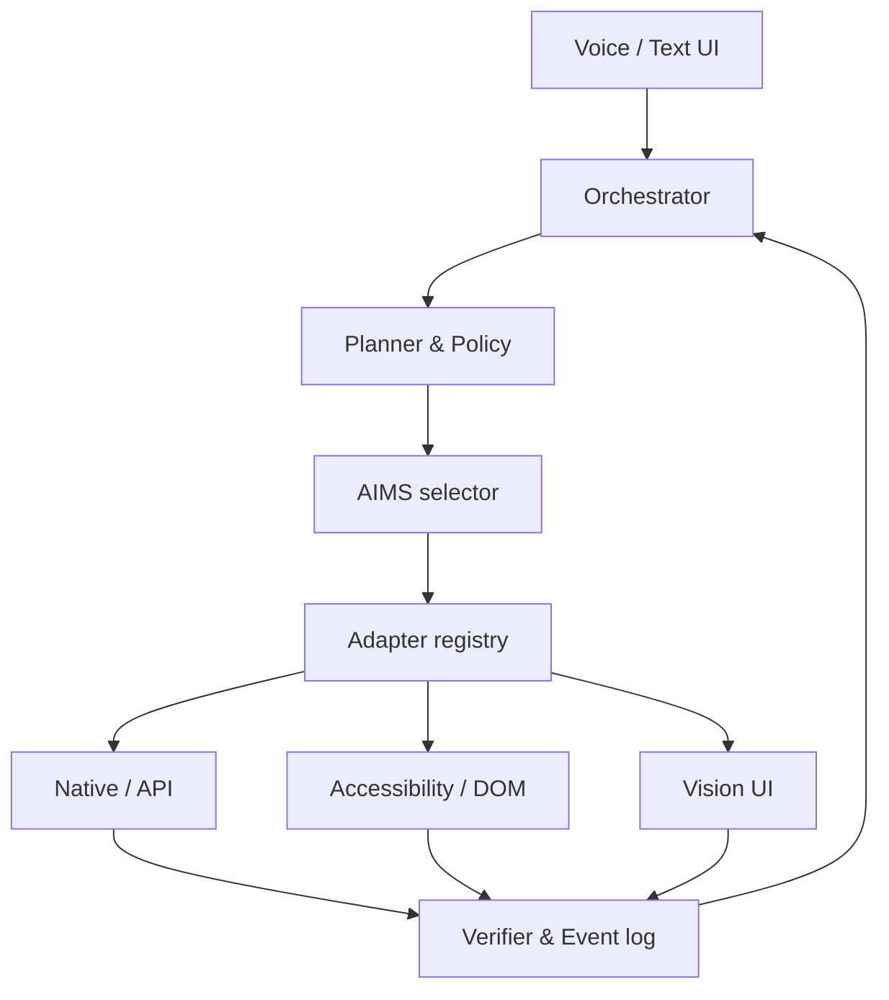

# Kiến trúc ELVION

## Trách nhiệm module

| Module | Trách nhiệm |
| --- | --- |
| Input | STT hoặc nhập chữ; chuẩn hóa yêu cầu, ngôn ngữ và ngữ cảnh phiên. |
| Orchestrator | Quản lý trạng thái phiên, giới hạn bước/thời gian, điều phối và xuất kết quả. |
| Planner | Phân rã mục tiêu thành các bước có điều kiện hoàn thành; không tự cấp quyền. |
| Policy | Quyền theo năng lực/ứng dụng, mức rủi ro, yêu cầu xác nhận và phạm vi dữ liệu. |
| AIMS | Liệt kê đường khả thi rồi chọn theo độ tin cậy, độ trễ và rủi ro dự kiến. |
| Registry + adapters | Một hợp đồng chung cho native/API, Accessibility, browser DOM, vision; mỗi adapter tự khai báo năng lực. |
| Verifier | Kiểm tra hậu điều kiện bằng tín hiệu độc lập hợp lý, hoặc trả `uncertain`. |
| Event log | Lưu quyết định và kết quả đã lược dữ liệu nhạy cảm phục vụ debug/đánh giá. |

## Một vòng thực thi

1. Chuyển yêu cầu thành `TaskRequest` và các bước `ActionIntent`.
2. Kiểm tra chính sách, trạng thái ứng dụng, quyền và khả năng từng adapter.
3. AIMS chấm các đường khả thi. Baseline: native/API nếu có hợp đồng đáng tin; Accessibility/DOM nếu truy cập hợp lệ; vision nếu các tín hiệu cấu trúc thiếu hoặc kém và quyền vẫn cho phép.
4. Với hành động cần xác nhận, hiển thị bản xem trước chứa đối tượng và tác dụng chính xác; chỉ thực thi sau khi người dùng đồng ý với chính hành động đó.
5. Adapter thực thi một bước, trả quan sát; verifier đánh giá hậu điều kiện. Nếu thất bại, cân nhắc đường dự phòng, không lặp hành động không idempotent khi chưa biết kết quả.
6. Ghi trace và trả kết quả, trạng thái không chắc chắn hoặc lý do dừng.

## AIMS baseline

`eligible = supported ∧ permission_granted ∧ policy_allowed ∧ prerequisites_met`. Với đường đủ điều kiện, ưu tiên mức thành công dự kiến, sau đó giảm rủi ro và độ trễ; phạt quan sát cũ, ứng dụng không ổn định và thao tác phá huỷ. Chính sách có quyền phủ quyết bất kể điểm số. Lưu `candidates`, lý do loại, điểm số và kết quả để đánh giá về sau. Học selector chỉ khi có đủ trace đáng tin và split theo ứng dụng/tình huống để tránh rò rỉ.

## Ranh giới tin cậy

Nội dung trang web, email, tin nhắn và văn bản trong UI là dữ liệu không đáng tin; không được biến thành lệnh hệ thống. Chỉ input trực tiếp từ người dùng hoặc xác nhận ràng buộc với một hành động cụ thể có thể ủy quyền tác dụng bên ngoài. Token tích hợp lưu trong Keychain; log ẩn token và nội dung riêng tư. Quyền Accessibility, microphone, automation do macOS cấp theo cơ chế chuẩn.
