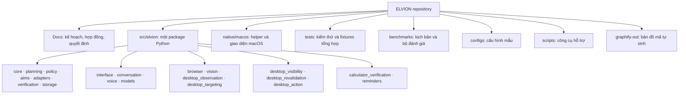

# Bản đồ repository ELVION

Ngày cập nhật: 01/11/2026. Bản đồ này giúp tìm nơi đặt mã và đọc phụ thuộc hiện có.
Quy tắc kiến trúc vẫn nằm ở [PROJECT_STRUCTURE.md](PROJECT_STRUCTURE.md),
[ARCHITECTURE.md](ARCHITECTURE.md) và [DECISIONS.md](DECISIONS.md). Đồ thị
Graphify là ảnh chụp mã tại thời điểm tạo, không phải quyền cho phép một module
gọi module khác.

## Sơ đồ thư mục



Các nhóm dưới `src/elvion/` chỉ để đọc sơ đồ; mỗi tên là một thư mục package
hiện có. Module mới nên đặt theo **trách nhiệm**, không theo tên ứng dụng bất kỳ.
`tests/` và `benchmarks/` có thể có thư mục con riêng cho từng năng lực.

## Đồ thị mã Graphify

- [graph.html](../graphify-out/graph.html): xem tương tác trong trình duyệt.
- [graph.json](../graphify-out/graph.json): nút, liên kết, nguồn và mức tin cậy
  để truy vấn hoặc xử lý bằng máy.
- [GRAPH_REPORT.md](../graphify-out/GRAPH_REPORT.md): tóm tắt cụm và nút trung tâm.
- [manifest.json](../graphify-out/manifest.json): dấu vết tệp cho cập nhật tăng dần.

Lượt cập nhật này dùng `graphifyy 0.9.99`, chế độ `--code-only`: Graphify
trích xuất lại 52 tệp mã mới/thay đổi, giữ 265 tệp không đổi trong manifest,
và tạo đồ thị 3.336 nút, 10.542 liên kết, 165 cụm. 109 tài liệu và 24 ảnh
được bỏ qua có chủ đích; sơ đồ thư mục phía trên đối chiếu bằng
`PROJECT_STRUCTURE.md` và thư mục hiện có. Không dùng model, API key, dữ liệu
cá nhân hoặc ảnh benchmark để suy ra cạnh. Báo cáo Graphify ghi commit HEAD;
vì repo có thay đổi chưa commit, phải hiểu graph là ảnh chụp **working tree**
ngày cập nhật, không phải đúng nguyên commit đó. `browser/reader.py` và
`tests/test_browser_reader.py` nay đã có trong graph; truy vấn xác nhận các
nút `extract_article()`, `read_page()` và `BrowserReaderTests`.

### Cập nhật

Graphify là công cụ phát triển riêng, không phải dependency runtime của ELVION.
Sau khi cài `graphifyy`, chạy ở gốc repo:

```sh
python3 -m graphify extract . --code-only --out .
python3 -m graphify cluster-only . --no-label
```

Kiểm tra `graphify-out/graph.json`, `graph.html`, `GRAPH_REPORT.md` và
`manifest.json` trước khi lưu phiên mới. Cache và file làm việc riêng của
Graphify được ignore. Nếu muốn lập graph từ tài liệu/ảnh, cần một quy trình
riêng về phạm vi và dữ liệu được phép đưa vào bộ trích xuất ngữ nghĩa.

### Cách đọc

Ưu tiên cạnh `EXTRACTED` khi nói về quan hệ trong mã. Cạnh `INFERRED` là suy
luận của công cụ, phải đối chiếu source trước khi coi là sự thật. Một import
không chứng minh luồng chạy thật hoặc ranh giới quyền đã được kiểm tra. Khi
sơ đồ và mã lệch nhau, kiểm tra mã rồi cập nhật tài liệu hoặc đồ thị tương ứng.
